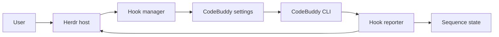

# Technical Design: CodeBuddy Integration

## Overview

A Herdr plugin manages CodeBuddy user hooks and translates supported lifecycle events into Herdr pane state and session reports. The integration follows the sibling ZCode plugin's operational model while using CodeBuddy's own hook schema and Herdr's documented combined state and resume report.

## Goals and Non-Goals

Goals are repeatable hook management, observable status, best-effort state reporting, session restoration and nonblocking behavior. The integration does not modify Herdr or CodeBuddy, bundle either CLI, manage unrelated configuration, or promise complete subagent and interruption tracking.

## Boundary Commitments

- **Owned:** plugin manifest and actions; integration-owned CodeBuddy hook entries; installed reporter; report sequencing and resume metadata; setup documentation and verification.
- **Out of Boundary:** CodeBuddy hook generation and session storage; Herdr's state display, authority arbitration and restore execution; unrelated hooks and settings; modifications to the sibling ZCode plugin.
- **Allowed Dependencies:** Node.js 18+ standard library; CodeBuddy Code v1.16.0+ hook/settings interface; Herdr plugin and pane CLI interfaces, with Herdr 0.9.2+ for resume; the user's shell and Git Bash on Windows. Version and platform support claims require actual verification.
- **Revalidation Triggers:** changes in CodeBuddy hook payloads, source identity, settings scopes or resume syntax; changes in Herdr manifest, pane report, sequence or resume contracts; runtime or supported-platform changes; evidence that the selected event mapping misreports activity.

## Architecture

The manager and reporter use Node built-ins only. The manager installs a stable copy of the reporter under the Herdr plugin configuration directory and embeds its absolute path and persistent sequence-state path into safely quoted CodeBuddy hook commands. The reporter does not depend on plugin runtime environment variables being present in the CodeBuddy process. The Herdr pane environment is read from the actual CodeBuddy process. Dependency direction is manifest → manager or reporter; each entrypoint uses Node built-ins and its documented external host interfaces. Neither entrypoint imports the other.

## File Structure Plan

All paths are relative to the repository root and are new unless stated otherwise.

| Path | Responsibility |
| --- | --- |
| `herdr-plugin.toml` | Plugin metadata, startup installation and workspace install, remove and status actions. |
| `scripts/manage_hooks.js` | CodeBuddy settings resolution, owned hook inventory, safe installation, removal and status. |
| `hooks/herdr_agent_state.js` | Validate hook input, map supported events, allocate report sequence and send Herdr state and resume information. |
| `tests/manage_hooks.test.js` | Exercise settings management, identity, preservation and error cases using isolated temporary homes. |
| `tests/herdr_agent_state.test.js` | Exercise event mapping, resume arguments, failure isolation and concurrent sequencing with a fake Herdr executable. |
| `README.md` | Installation, prerequisites, activation, troubleshooting, supported versions and observed limitations. |
| `LICENSE` | Applicable license notice for any reused reference code. |

## Components and Interfaces

### Plugin manifest

The manifest supplies a stable plugin ID, `min_herdr_version = "0.9.2"`, declared supported platforms, startup installation, and workspace actions with local IDs `install-hooks`, `remove-hooks` and `status`. Commands are argv arrays invoked from the plugin root with `node scripts/manage_hooks.js <action>`. Herdr supplies plugin config and state directories to actions and startup. Startup failures must be visible in the Herdr plugin log. A linked or enabled plugin does not automatically run startup immediately; users can invoke the install action explicitly.

### Hook manager

**Contract:** `node scripts/manage_hooks.js install|remove|status`. Install and remove return nonzero with actionable stderr on failure; status identifies installed, absent, incomplete or undeterminable and reports the individual integration entries. `CODEBUDDY_CONFIG_DIR`, when set, identifies the configuration root; otherwise use the user's `.codebuddy` directory. The target is its `settings.json`.

The manager maintains one event inventory shared by all three actions. Initially register `SessionStart`, `UserPromptSubmit`, `PreToolUse`, `PostToolUse`, `Stop`, and `Notification` filtered to `permission_prompt`; exact registration must be checked against the documented version and real CLI. Each entry is a CodeBuddy command hook pointing to the stable reporter and identifies its event using the validated stdin payload. Match tool events broadly. Use an exact, versioned integration marker in the generated command for ownership; do not remove an entire matcher group containing unrelated hooks. Adopt no legacy hook by fuzzy path or name matching.

Installation creates the settings file only if absent, retains other JSON values and groups, replaces only exactly identified owned hooks, and is repeatable. Removal deletes only owned entries and empty groups created by their removal. Status compares the full inventory and reporter availability; malformed or unreadable settings are undeterminable. Write a temporary file in the same directory and replace the target only after successful parsing and serialization. Serialize this integration's own concurrent management actions with a bounded lock. Detect external modifications between read and replacement and abort with an actionable conflict rather than knowingly overwrite changes; ordinary file APIs cannot make this a transaction with uncooperative editors, so document this residual race. Preserve permissions where supported. Never replace malformed settings with defaults. Resolve and quote paths for the shell in use, including spaces and apostrophes; exercise Windows Git Bash explicitly.

### Hook reporter

**Input contract:** One JSON object on stdin, including `hook_event_name`, optional nonempty `session_id`, optional `generation_id`, and event-specific fields such as `notification_type`. Validate types and bound input size; malformed or unsupported input becomes a silent no-op. Do not emit hook stdout or include prompt, tool contents, or transcript contents in Herdr calls. Require `HERDR_ENV=1`, `HERDR_PANE_ID`, `HERDR_BIN_PATH`, and `HERDR_SOCKET_PATH`; otherwise exit successfully without reporting.

| Event | Report | Notes |
| --- | --- | --- |
| `SessionStart` with source `startup` or `resume` | idle | Attach valid session and resume argv. Clear and compact source handling must not be mistaken for process exit; refresh session metadata when supplied. |
| `UserPromptSubmit` | working | Start a turn. |
| `PreToolUse`, `PostToolUse` | working | Tool activity; verify main/subagent behavior. |
| `Notification` with `permission_prompt` | blocked | No prompt contents are copied. |
| `Stop` | idle | Manual interruption can omit this event. |

The `generation_id` is correlation data only, never an ordered number. When source identity reliably distinguishes subagent events, ignore subagent tool activity for pane state; otherwise behavior is best effort and documented. A subsequent supported working or stop event updates the state after a permission prompt; no universal resolution event is assumed. `SessionEnd` is not used to release because `clear` and other reasons do not reliably prove process termination; Herdr's idle-shell cleanup is the fallback.

**Herdr contract:** Invoke `HERDR_BIN_PATH` with an argv array equivalent to `pane report-agent <pane> --source herdr-codebuddy-plugin --agent CodeBuddy --state <state> --seq <number>`. Whenever any supported event supplies a valid session ID, add `--agent-session-id <id> -- codebuddy --resume <id>` to that event's state report. This ensures restore information reaches Herdr even if the session ID first appears after `SessionStart`. Use no shell for this invocation. Before attaching a resume command validate Herdr's constraints: a plain command name, no apostrophes or control characters in any argument, at most 64 arguments and 8 KiB total. If session metadata is absent or invalid, send the state without resume metadata; do not fabricate an ID. Report session updates to the pane that supplied the event.

**Sequence contract:** Maintain a source-wide monotonically increasing integer in the persistent plugin state path. Use a bounded cross-process exclusive lock, read and validate the current value under lock, choose a strictly larger safe integer even when clocks collide or move backwards, persist it before unlocking, and use it for the report. No lock means no report: never reuse or invent an unsafe sequence after lock failure, corrupt state or overflow. Do not automatically break an apparently stale lock without proving ownership has ended; surface recovery instructions in documentation. A later allocated sequence suppresses a delayed earlier report in Herdr. If events arrive in an order different from their actual occurrence, the integration cannot infer the original order and the displayed state may temporarily be wrong. Report using a short bounded timeout, suppress subprocess output, and always exit successfully so CodeBuddy continues.

## Requirements Traceability

| IDs | Component and behavior |
| --- | --- |
| 1.1, 1.2, 1.3, 1.4, 1.5, 1.6 | Hook manager installation, exact ownership, preservation and failures |
| 2.1, 2.2, 2.3 | Hook manager inventory comparison and status errors |
| 3.1, 3.2, 3.3, 3.4, 3.5 | Reporter event mapping |
| 3.6, 3.7 | Reporter sequence contract and documented ordering limitation |
| 4.1, 4.2, 4.3, 4.4 | Reporter attaches resume metadata to every supported event carrying a valid session ID; Herdr restores the registered pane session |
| 5.1, 5.2, 5.3 | Reporter environment validation, bounded failures and silent stdout |
| 6.1, 6.2, 6.3, 6.4 | README setup, compatibility, review and limitations |

## Testing Strategy

- **Manager:** Isolated settings fixtures exercise missing settings, preexisting unrelated hooks within the same matcher, repeated install, partial status, removal, malformed and unreadable files, writes failing, concurrent manager actions, external-change detection, and paths containing spaces or apostrophes. Assert owned-hook inventory and unrelated values rather than formatting (1.1–1.6, 2.1–2.3).
- **Reporter:** Feed documented JSON events and capture a fake Herdr executable's argv; assert state, pane ID, source, resume ID and argv on `SessionStart` and on later supported events carrying a session ID, invalid/missing IDs, non-Herdr environments, malformed input, no stdout, failed or timed-out calls, and no prompt data in arguments (3.1–3.5, 4.1, 4.3–4.4, 5.1–5.3).
- **Concurrency:** Launch competing reporter processes against isolated persistent state with controlled clock collisions; assert unique increasing allocations, no duplicate sequences and delayed lower reports rejected by a fake Herdr sequence filter. Exercise lock contention, corrupt state and write failure. Test that unordered delivery is treated as best effort rather than falsely asserting source order (3.6–3.7).
- **Live integration:** In an isolated named Herdr session, install hooks, restart or review them as CodeBuddy requires, send a prompt, request permission, finish a turn, inspect Herdr state, restart Herdr and verify the same session resumes. Exercise two panes, resume, `/clear`, subagents, interruption, and configuration overrides. Record actual CodeBuddy, Herdr, Node and OS versions; verify Windows quoting with Git Bash before declaring Windows support (1.1, 3.1–3.7, 4.1–4.4, 6.2–6.4).
- **Documentation:** Check instructions match the actual manifest and tested version/platform matrix, and explain `/hooks`, snapshots, runtime prerequisites and state limitations (6.1–6.4).

## Rollout and Risks

Run tests using temporary settings and an isolated Herdr session; never alter a user's existing setup during automated tests. Ship only platform/version support demonstrated by those tests. Hooks are beta, so payload and subagent behavior may change; failed reporting intentionally degrades to continued CodeBuddy operation. A settings file modified by an unrelated program during the final replacement window can still race despite conflict detection; users should avoid simultaneous configuration edits during installation. Restore relies on Herdr's restore settings and the `codebuddy` command being available on PATH.
